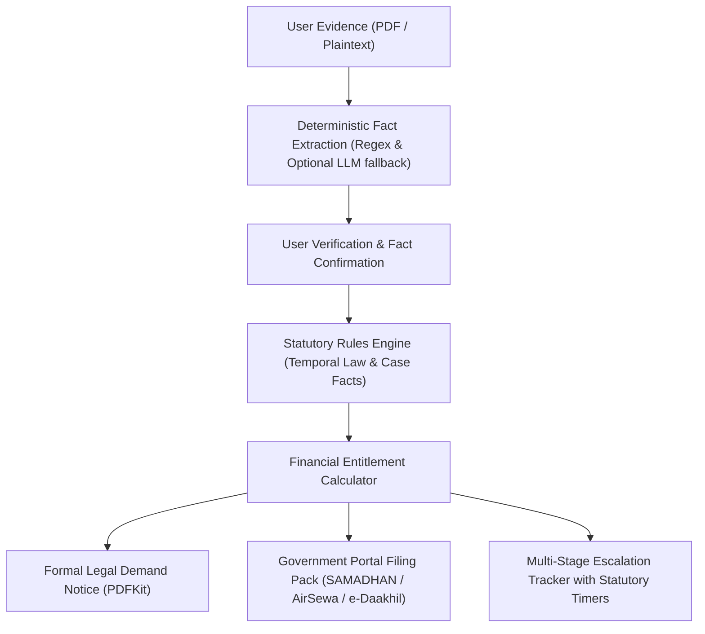

# NyayaSetu (न्यायसेतु)

**Bridging citizens to statutory rights and calculated legal recovery.** NyayaSetu processes legal agreements and evidentiary records, evaluates them against Indian statutory legislation and regulatory mandates, computes deterministic financial entitlements, generates formal legal demand notices and PDF complaints, and tracks multi-tier escalation deadlines until resolution.

- **Live Application:** _[Deploy via Vercel]_
- **Backend API:** _[Deploy via Render]_ (Health check: `/api/health`, Meta: `/api/meta`)
- **Demo Video:** _[Attach video link]_
- **Sample Verification Files:** [`demo-documents/`](demo-documents/) contains realistic test documents for each case domain with expected statutory calculations.
- **Project Submission:** End-Term Software Engineering Capstone Project.

---

## 1. Problem Statement

Across India, hundreds of thousands of citizens are unlawfully denied financial dues despite clear statutory protections:

- **Employment Exit & Final Settlement:** Under the new Labour Codes (in force from 21 November 2025), final wages and settlements must be disbursed within **two working days** of separation, and fixed-term employees qualify for statutory gratuity after a single year of continuous service. Employers frequently withhold final settlements, arbitrarily deduct notice periods, or refuse gratuity.
- **Flight Cancellations & Disruptions:** Airlines routinely deny passengers statutory compensation mandated by DGCA Civil Aviation Requirements (CAR Section 3, Series M, Part IV), offering only bare ticket refunds instead of the mandatory ₹5,000–₹10,000 cancellation indemnity.
- **Rental Security Deposits:** Landlords routinely make arbitrary deductions for "painting", "deep cleaning", or unverified "damages" without enabling clauses in the registered agreement or valid invoices, violating the Indian Contract Act, 1872 and the Model Tenancy Act, 2021.

Citizens lack legal representation, fail to navigate complex statutory formulas, miss procedural deadlines, and often give up or pay predatory intermediaries.

## 2. Solution Architecture

NyayaSetu replaces legal ambiguity with a 4-step deterministic pipeline:



> **Design Principle:** Zero AI Hallucination. AI models (if enabled) are strictly sandboxed to initial unstructured document extraction. All legal conclusions, statutory eligibility tests, and financial breakdowns are computed by **100% deterministic, audit-traceable code**.

---

## 3. Core Modules & Supported Packs

1. **Employment Exit & Gratuity Pack:**
   - **Governing Law:** Code on Wages 2019 s.17(2), Code on Social Security 2020 s.53, Indian Contract Act 1872 s.27.
   - **Escalation Path:** Written HR Demand (7 days) &rarr; Legal Demand Notice (15 days) &rarr; Ministry of Labour SAMADHAN Portal (45 days).
2. **Flight Disruption Pack:**
   - **Governing Law:** DGCA CAR Section 3, Series M, Part IV.
   - **Escalation Path:** Airline Customer Service (14 days) &rarr; AirSewa Ministry Portal (30 days) &rarr; e-Jagriti National Consumer Forum.
3. **Rental Security Deposit Pack:**
   - **Governing Law:** Indian Contract Act 1872 s.73, Model Tenancy Act 2021 s.11, State Tenancy Laws.
   - **Escalation Path:** Landlord Formal Notice (15 days) &rarr; Rent Authority / Consumer Dispute Redressal Commission.

---

## 4. Engineering Depth & Features

* **State Machine Escalation Engine:** Strictly validates legal status transitions (`draft` &rarr; `confirmed` &rarr; `sent` &rarr; `waiting` &rarr; `escalated` &rarr; `resolved`), enforcing statutory reply windows and preventing invalid state jumps.
* **Temporal Rule Engine:** Evaluates active legislation based on event dates (e.g., automatically applying the 2-working-day payment rule for exits post-Nov 2025 versus legacy Payment of Wages Act rules for earlier exits).
* **Deterministic Document Extraction:** Built-in zero-key regex pattern extractor that extracts key facts from payslips, agreements, and tickets without external API costs or latency.
* **On-the-Fly Legal PDF Compilation:** Streams clean, professional legal demand notices and consolidated case audit dossiers using `PDFKit`.
* **Security & Auth:** Secure JWT authentication, Bcrypt password hashing, Helmet HTTP security headers, CORS origin whitelisting, and strict per-route rate limiting.

---

## 5. Technology Stack

- **Frontend:** React 18, Vite 5, TailwindCSS, Framer Motion, TanStack Query, Lucide Icons, Three.js / React Three Fiber.
- **Backend:** Node.js 22+, Express, Mongoose / MongoDB Atlas, Zod schema validation, PDFKit, pdfjs-dist.
- **Testing:** Native Node.js test runner (`node --test`), 27 unit and integration tests passing.

---

## 6. Environment Configuration

### Backend (`server/.env`)

| Variable | Required | Description |
|---|---|---|
| `MONGODB_URI` | Yes | MongoDB connection string (`mongodb://localhost:27017/nyayasetu` or Atlas cluster) |
| `JWT_SECRET` | Yes | 64-character random cryptographic secret |
| `PORT` | No | Server port (default: `5001`) |
| `CLIENT_ORIGIN` | Yes in prod | Allowed frontend origins (e.g. `http://localhost:5173`) |
| `LLM_PROVIDER` | No | Document AI extraction (`none` uses fast pattern reader; `openrouter` / `gemini`) |
| `ADMIN_EMAIL` | No | Seed administrator email (default: `admin@nyayasetu.in`) |
| `ADMIN_PASSWORD` | No | Seed administrator password |

### Frontend (`client/.env`)

| Variable | Description |
|---|---|
| `VITE_API_URL` | Backend API base URL including `/api` (default: `http://localhost:5001/api`) |

---

## 7. Local Setup & Testing

### 1. Backend Setup
```bash
cd server
npm install
npm test            # Run all 27 unit and integration tests
npm run dev         # Launches server on http://localhost:5001
```

### 2. Frontend Setup
```bash
cd client
npm install
npm run build       # Verifies production Vite bundle
npm run dev         # Launches client on http://localhost:5173
```

---

## 8. API Endpoints

- `GET /api/health`: Health status, uptime, and database connection.
- `GET /api/meta`: Application metadata, supported legal domains, and active capabilities.
- `POST /api/auth/register` & `POST /api/auth/login`: User authentication.
- `GET /api/packs`: List all available legal claim packs.
- `POST /api/cases`: Create a new legal claim case.
- `POST /api/cases/:id/documents`: Upload evidence files for deterministic extraction.
- `GET /api/cases/:id/letter`: Download generated legal demand notice PDF.
- `POST /api/cases/:id/transition`: Transition case along statutory escalation ladder.
- `GET /api/cases/:id/case-file`: Download comprehensive legal docket PDF.
